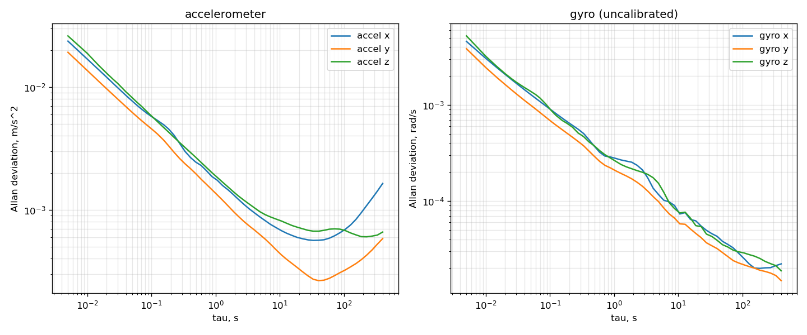

# IMU noise: how it was measured, and what the estimator uses

The estimator (`Appli/App/inekf.c`) propagates the robot's orientation,
velocity and position from the IMU every sample, and corrects them with leg
kinematics whenever a foot is on the ground. How much it trusts the IMU against
the legs is set by four noise numbers. Until 2026-11-21 those were guesses.
This page records how they were measured on the robot's own BNO085, what came
out, and what the firmware now uses.

## The four numbers, and what each one does

| Setting in `inekf_default_params()` | What it describes | Too low | Too high |
|---|---|---|---|
| `noise_gyro` | random jitter on each gyro sample | trusts the gyro, orientation drifts confidently between steps | orientation leans on the legs and gets jumpy |
| `noise_accel` | random jitter on each accelerometer sample | velocity coasts on the IMU between steps and drifts | every foot contact yanks the velocity |
| `noise_gyro_bias` | how fast the gyro's zero offset wanders | bias estimate freezes and cannot follow warm-up | the legs' noise leaks into the bias estimate |
| `noise_accel_bias` | the same for the accelerometer | as above | as above |

All four are **continuous-time densities**. The prediction step adds
`Qbar * dt`, so the same numbers are right at any sample rate. That is also the
form an Allan deviation plot gives them in, which is why the plot maps straight
onto the code.

## How the data was captured

The method was one hour of the IMU sitting perfectly still on the assembled
robot, recorded raw.

- **Firmware mode** `NEXUS_MODE_IMU_LOG` (`Appli/App/test_imu_log.c`). It
  touches only the IMU: no CAN, no encoders, no USB link.
- **Reports:**
  - accelerometer, SH-2 `0x01`: calibrated, includes gravity
  - **gyroscope uncalibrated**, SH-2 `0x07`
  - each at 400 Hz
  - the rotation vector turned off, because producing it starves the other
    reports
- **Why the uncalibrated gyro.** The calibrated one (`0x02`) has the sensor's own
  bias estimate subtracted, and it re-estimates that bias continuously. That
  flattens exactly the slow drift this test exists to measure. It is also a
  second estimator fighting the InEKF's bias state, so the robot uses `0x07`
  as well.
- **Transport.** The data goes over the ST-LINK virtual COM port at 115200 baud,
  in binary frames: `A5 5A type len payload sum8`.
  - 400 Hz text would need about 25 kB/s, against roughly 11.5 kB/s on the
    wire. So each frame is the **mean of the samples in a 5 ms window**: 200
    frames/s, 6.8 kB/s.
  - Averaging two samples changes nothing an Allan plot reads. Its shortest
    useful window is already longer than 5 ms, and the white-noise figure is
    read at 1 s.
- **Capture:** `tools/imu_allan/capture.py --minutes 62 --out imu_still.bin`
  on the laptop. It writes the raw serial bytes and prints a status line every
  10 s.
- **Conditions:** the robot was still, leaning slightly backwards on its stand,
  at room temperature, with motors unpowered. The first 2 minutes were
  discarded as warm-up.
- **Data quality:**
  - 735,857 frames over 61.3 minutes, 1 bad checksum, nothing dropped by the
    board's console.
  - 1.3 % of 5 ms windows held no new sample, because the sensor's output timing
    jitters. Those were filled by linear interpolation before analysis; a
    handful of interpolated points in an hour moves nothing.

The raw recording is not in git (24 MB). It is on the bench laptop at
`~/zeus_logs/imu/imu_still_2026-11-21_60min.bin`.

## The analysis: Allan deviation

`tools/imu_allan/allan.py imu_still.bin --png plot.png` does the following:

1. Decodes the frames and fills gaps by interpolation, giving an even 200 Hz
   grid.
2. For each axis, computes the **overlapping Allan deviation**. It averages the
   signal over windows of length τ, from 5 ms up to about 1/9 of the recording,
   and measures how much consecutive averages differ.
3. Reads three things off each curve:
   - **N, white noise** (the slope −½ region, read at τ = 1 s). Averaging longer
     helps, at the rate white noise predicts.
   - **B, bias instability** (the lowest point, divided by 0.664). Averaging stops
     helping.
   - **K, bias random walk** (the slope +½ region, read at τ = 3 s). Averaging
     makes it worse, because the zero itself is moving. If there is no +½
     region within the hour, K is reported as an upper bound from the last
     point.
4. Prints the mapping onto `inekf_params_t`: `noise_gyro = N_gyro`,
   `noise_accel = N_accel`, `noise_gyro_bias = K_gyro`,
   `noise_accel_bias = K_accel`, worst axis, with 1.5× margin.

The tool was checked on synthetic data with known noise (white 2e-3 and 5e-3
plus a bias walk), and it recovered N to three figures.



## Results (chip axes)

| Axis | N, white | B, bias instability | K, bias walk |
|---|---|---|---|
| accel x | 1.71e-3 m/s²/√Hz | 8.5e-4 m/s² | 1.16e-4 m/s³/√Hz |
| accel y | 1.33e-3 | 4.0e-4 | 4.9e-5 |
| accel z | 1.84e-3 | 9.1e-4 | < 5.7e-5 (bound) |
| gyro x | 2.87e-4 rad/s/√Hz | < 3.0e-5 rad/s | < 1.9e-6 rad/s²/√Hz (bound) |
| gyro y | 2.04e-4 | < 2.2e-5 | < 1.3e-6 (bound) |
| gyro z | 3.14e-4 | < 2.8e-5 | < 1.6e-6 (bound) |

**The gyro** keeps averaging down along the −½ slope all the way to about 300 s
and never reaches a floor. Its bias hardly moves within an hour while still.
B and K are therefore upper bounds, not measurements.

**The accelerometer** bottoms out around 30 s and then rises, X most of all.
That is slow drift: temperature, or the robot settling against its stand. Either
way it is real behaviour the filter must allow for.

**Biases at rest**, measured as the mean over the hour:

| | Chip frame | Robot frame (X fwd, Y left, Z up) |
|---|---|---|
| gyro | (−0.94, +2.30, −2.44) mrad/s | (−2.30, −0.94, −2.44) mrad/s |
| accel | (−1.424, −1.546, +9.540) m/s² | (+1.546, −1.424, +9.540) m/s² |

- **Gyro bias:** about 2–3 mrad/s per axis. The filter is told it could be up to
  5 mrad/s at start-up (`init_gyro_bias`), which covers it.
- **The accel reading is mostly gravity, not bias.** The robot was leaning about
  9° nose-up and 8° onto its left side, so gravity shows up partly on X and Y.
  Its magnitude, |a| = **9.769 m/s²**, is 0.4 % short of 9.81. That about
  0.04 m/s² offset is inside `init_accel_bias` (0.05) and is what the filter's
  accel bias state absorbs.
- **These are not hard-coded anywhere.** Bias changes from one power-up to the
  next, so the filter estimates it every run. The measured values only confirm
  that the starting uncertainty is large enough.

## What the firmware uses

`Appli/App/inekf.c`, `inekf_default_params()`:

| Setting | Before (guess) | Measured floor (worst axis) | **Used now** |
|---|---|---|---|
| `noise_gyro` | 2.0e-3 | 3.1e-4 | **1.0e-3** rad/s/√Hz |
| `noise_accel` | 4.0e-2 | 1.8e-3 | **1.0e-2** m/s²/√Hz |
| `noise_gyro_bias` | 1.0e-3 | < 2e-6 | **1.0e-5** rad/s²/√Hz |
| `noise_accel_bias` | 1.0e-3 | 1.2e-4 | **5.0e-4** m/s³/√Hz |

**Why not the measured floor itself:** this was a still robot. Walking adds motor
vibration, foot impacts, timing jitter between IMU and joint samples, and
lever-arm error, and every one of them reaches the filter looking like IMU
noise. The values used sit 3–6× above the floor for that reason. The rule
going forward:

- **Never below the measured floor.** That claims the sensor is better than it
  is.
- **Tune upward from here against walking recordings.** The flight recorder in
  `zeus_8dof_deploy` captures every packet of every run, and an offline replay
  through this same filter is the way to tune.

The walk simulation (`tools/sim/run.sh --check`) passes with these values:
walking velocity RMS 0.018 m/s, height RMS 0.022 m, and both biases recovered.

Two related changes went in with this, both needed for the numbers to mean what
they say:

- **ROBOT mode uses the uncalibrated gyro** (`imu_use_uncal_gyro(1)` in
  `app_init()`). The test above characterised that report, so the filter must
  be fed the same one.
- **The IMU's mounting is applied in the driver** (`g_imu_mount_R` in
  `robot_config.c`). The chip sits with X pointing left, Y back and Z up, a 90°
  yaw. Every reading is rotated into the robot frame as it arrives, so the
  filter, the state packet and the policy never see chip axes. Noise densities
  are per axis, so the rotation only relabels which row of the table above is
  which robot axis.

## Repeating the test

Do it again if the IMU is replaced, remounted, or the filter starts to look
wrong in a way the legs cannot explain.

```bash
# 1. firmware: set NEXUS_MODE to NEXUS_MODE_IMU_LOG in Appli/App/nexus_mode.h, build, flash
# 2. robot completely still, nothing touching it, for the whole run
python3 tools/imu_allan/capture.py --minutes 62 --out imu_still.bin
# 3. analyse; --skip drops warm-up minutes, --stop cuts a disturbed tail
python3 tools/imu_allan/allan.py imu_still.bin --skip 2 --png allan.png
# 4. set NEXUS_MODE back
```

Bumps during the run show as steps in the status line's gyro. Note the minute,
and cut it with `--skip` or `--stop` rather than restarting the hour.
